# Odysseus

**A fast GTK4 / libadwaita file manager for Linux, with the look of Nautilus and the power of its extensions built in.**
**Gestionnaire de fichiers GTK4 / libadwaita rapide, au look de Nautilus, avec ses extensions intégrées.**

[English](#english) · [Français](#français)

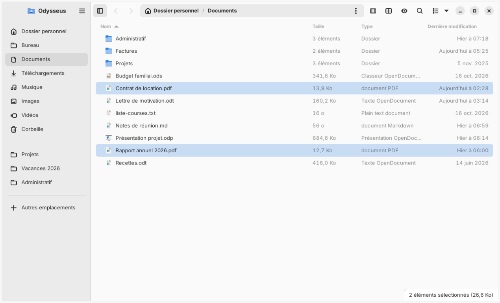

| Dual panel / Double panneau | Column view / Vue en colonnes | Grid / Grille |
|---|---|---|
| 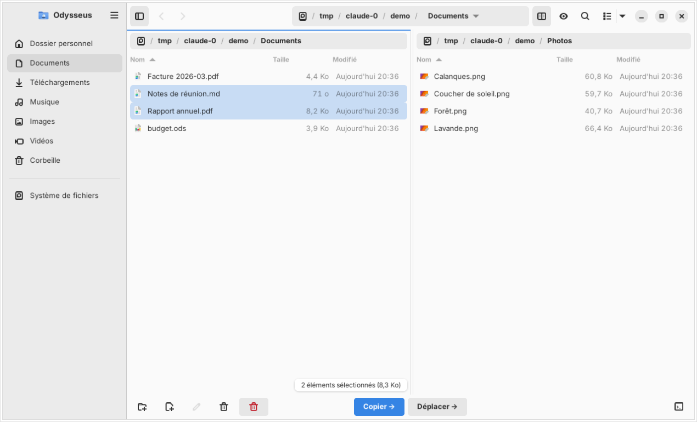 | 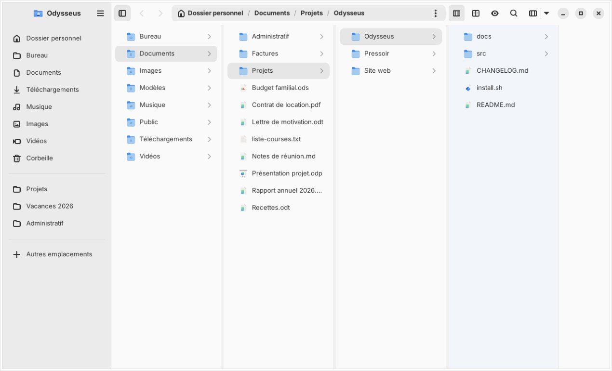 | 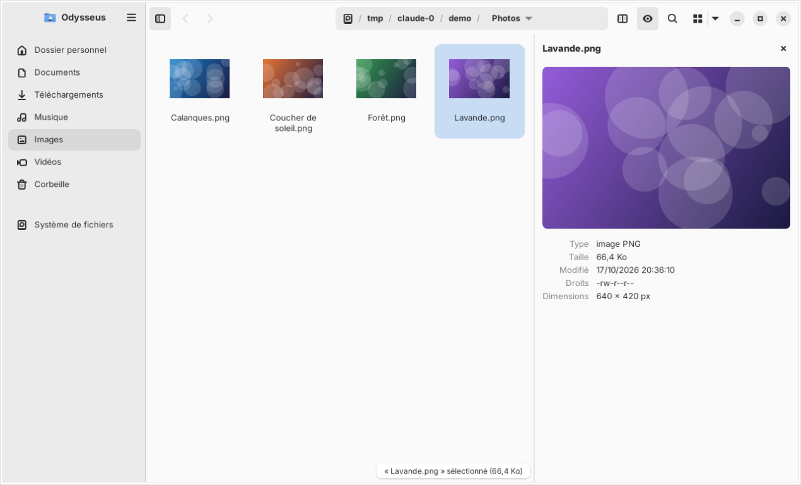 |

| Archive browser / Archive ouverte | PDF watermark / Filigrane PDF | Other locations / Autres emplacements |
|---|---|---|
| 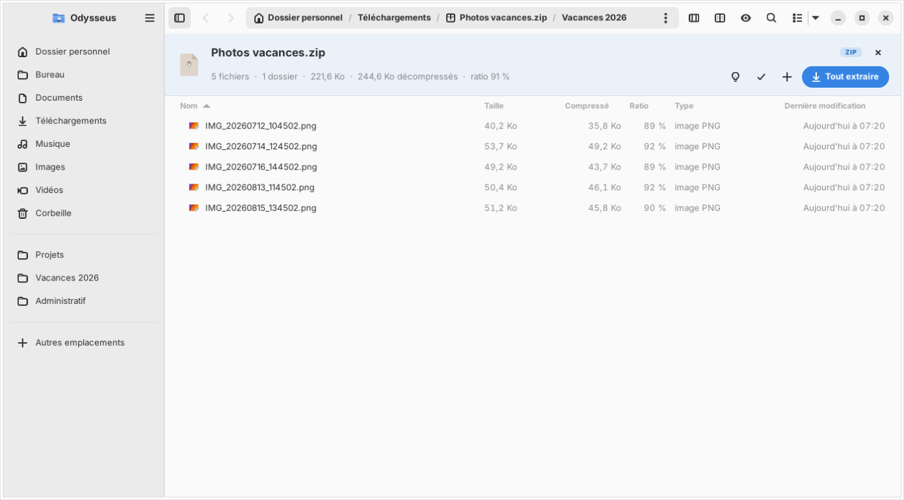 | 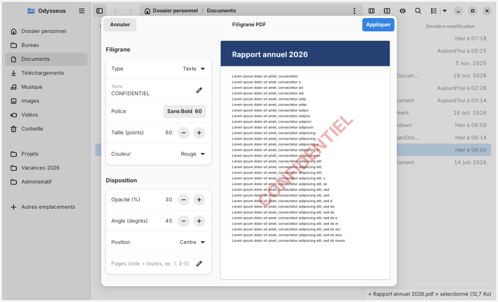 | 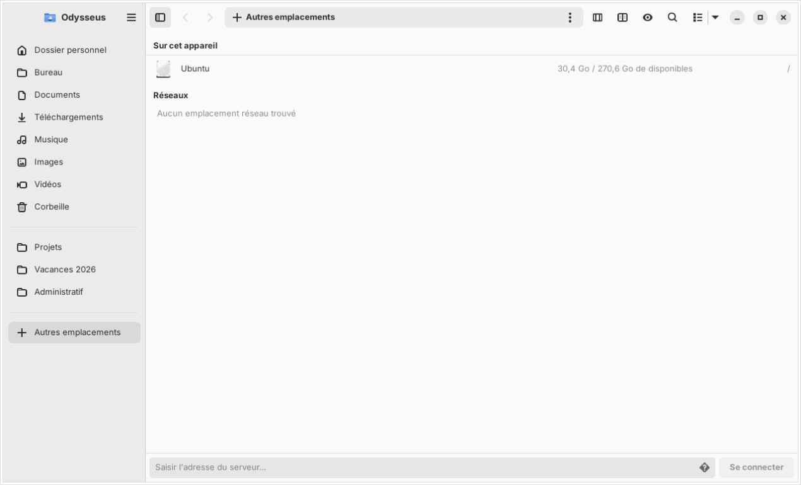 |

| Batch rename / Renommage multiple | Image tools / Outils image | Properties / Propriétés |
|---|---|---|
| 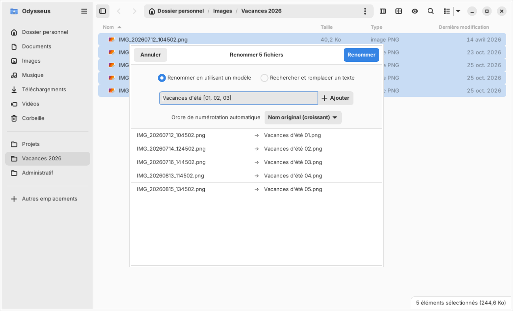 | 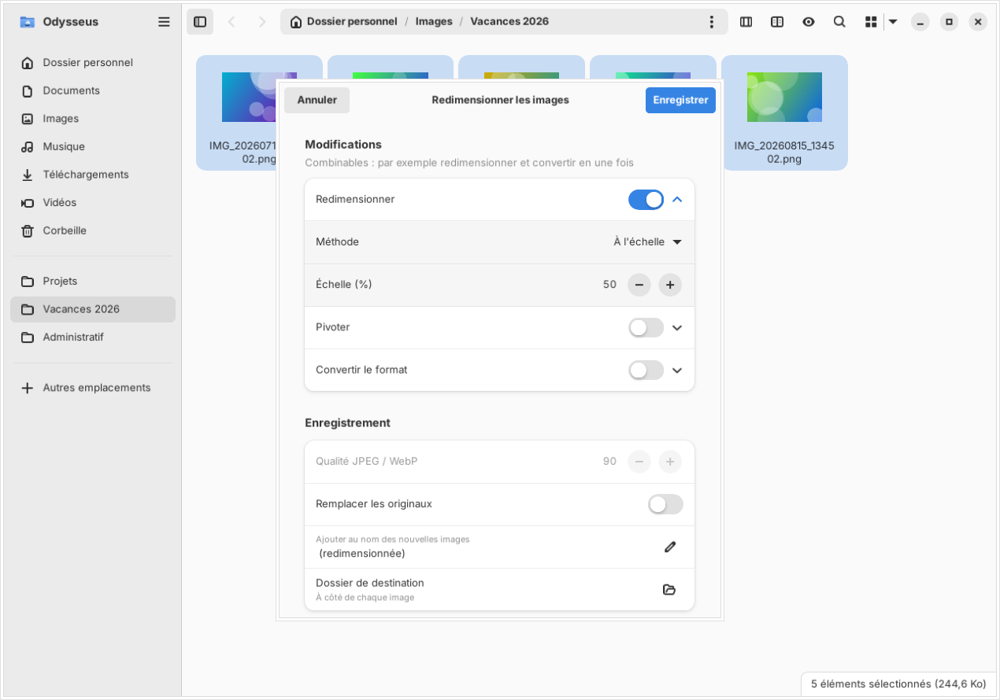 | 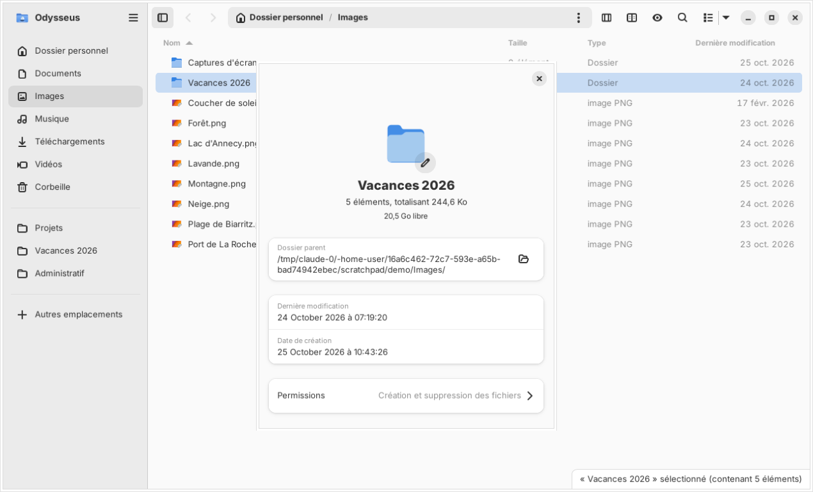 |

| This PC / Ce PC | Features / Fonctionnalités | Dark mode / Mode sombre |
|---|---|---|
| 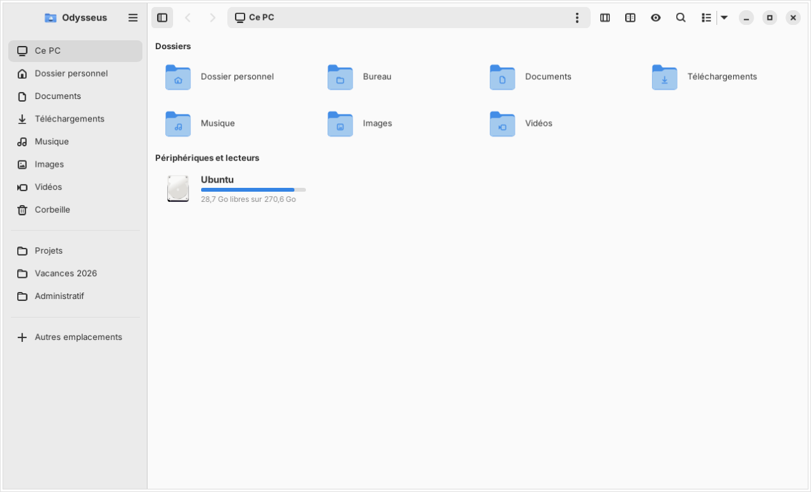 | 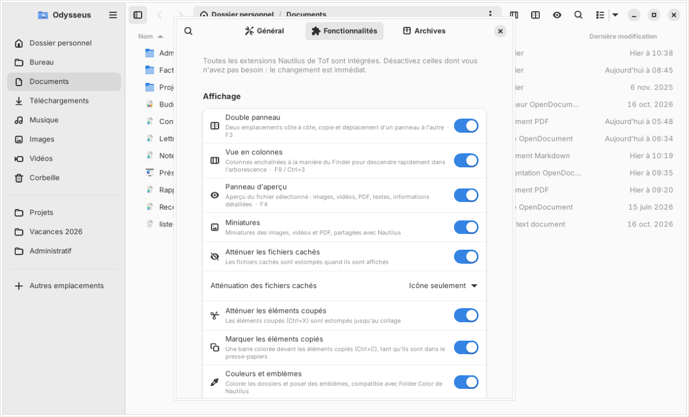 | 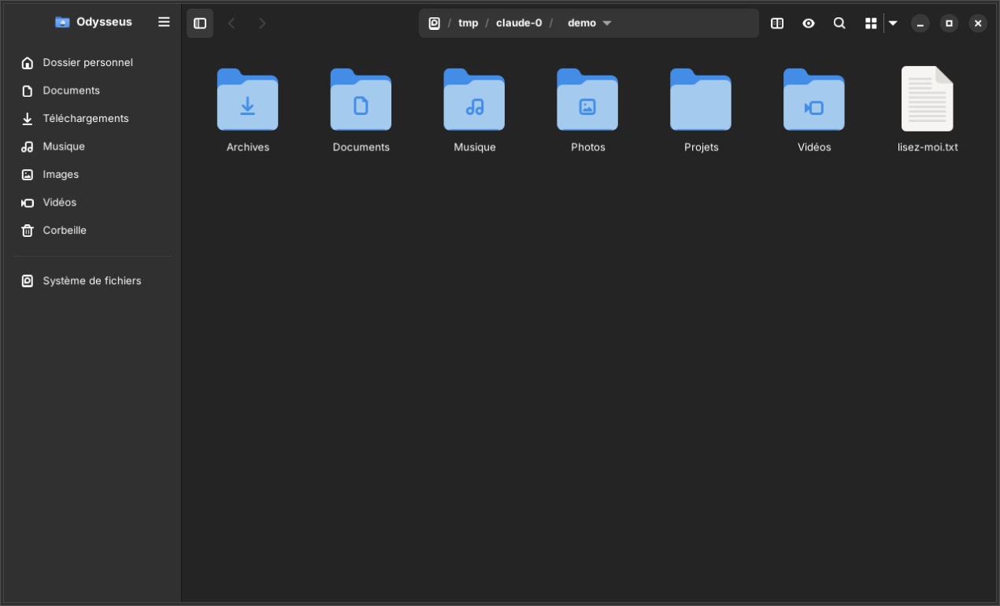 |

---

## English

Odysseus is a file manager that looks and behaves like GNOME Files (Nautilus) and natively includes every feature of the [nautilus-extensions](https://github.com/ToFpon/nautilus-extensions) collection. Each feature can be turned off in **Preferences → Features**, without restarting. The external programs they use (7-Zip, qpdf, FFmpeg…) are listed in **Preferences → Components**, with the command that installs the missing ones. It follows your desktop's GTK4 theme (Adwaita, light/dark, accent color, or a theme installed in `~/.config/gtk-4.0/`). The archive engine comes from [Pressoir](https://github.com/ToFpon/Pressoir).

### Speed

Huge folders open almost instantly: a folder of **100,000 files is displayed in about one second**.

- the folder is read with `os.scandir` in a background thread; names appear first, sizes and dates follow;
- the views use a virtual list model: row objects are only created for the rows on screen;
- metadata reads (`stat`) of all panels and columns are serialized through a single lock, which avoids the Python GIL “convoy” effect that made two panels ten times slower than one;
- only the visible view (list, grid or columns) is attached to the model;
- thumbnails and folder sizes are computed in a LIFO worker pool: what you are looking at comes first.

### Features

#### Views (from Dual Panel, Column Browser, Preview Panel…)
- **List** (compact 35 px rows like Nautilus, optional columns: size, type, date, permissions, owner, duration), **grid** (64 to 256 px) and **columns** (Miller columns, resizable, ← / → between columns). Ctrl+1 / 2 / 3, Ctrl+plus / minus / 0 or Ctrl+mouse wheel.
- **Dual panel** (F3): two locations side by side, F6 / Shift+F6 copy or move to the other panel, Ctrl+Tab switches panels.
- **Preview panel** (F4): images, videos, PDF pages, text, detailed information.
- **Each folder keeps its own sort order** (menu, column header or right-click → Sort), shared with Nautilus; the default one is set in Preferences.
- **Thumbnails** shared with Nautilus (freedesktop cache).
- Hidden files dimmed (icon only or icon and name), cut items dimmed until pasted, a colored bar in front of copied items.
- **Folder colors and emblems**, compatible with Folder Color.
- **Duration column** for audio and video files (ffprobe, cached).
- File types detected like Nautilus: when the name is not enough (`.bashrc`, `script.sh.bak`…), the start of the file is read. The view follows files replaced in the background (a finished download gets its real icon).
- The status bar at the bottom fades out under the pointer, and lists keep some room below the last item, like Nautilus.

#### Files
- Tabs, history, breadcrumb path bar with Tab completion (a mounted disk starts the path, like Nautilus), bookmarks shared with GTK, Recent (shown or hidden with GNOME's file history setting), Trash (restore, empty), Network, devices with the same eject rules as Nautilus (no eject button for fstab and internal disks).
- **Type to jump to a file** (optional, Preferences → General): typing the start of a name selects the file without filtering the list, like Nemo or Thunar; by default, typing starts a search, like Nautilus.
- **This PC** (optional, Preferences → General → Sidebar): for those coming from Windows, your folders and all your drives on one page, with a usage bar and the free space of each drive. The Desktop entry of the sidebar is optional too.
- **Batch rename** (F2 on several items), the Nautilus 46 dialog: a template with tags (original name, numbering 1, 01, 001, date taken, camera, artist, album, track…) or find and replace, live preview with the changes highlighted, conflicts shown before anything is renamed, one Ctrl+Z to undo it all.
- **Quick Look** with the space bar, like Nautilus: GNOME's previewer (Sushi) shows the selected file, and the arrow keys move through the folder.
- **Properties** laid out like Nautilus 46: size under the name, free space, dates, a custom folder icon (seen by Nautilus too), permissions on their own page, with “Change Permissions for Enclosed Files…”.
- Copy / move with conflict dialog (skip, rename, merge, replace, apply to all), **progress window** for long operations, undo (Ctrl+Z), drag and drop, clipboard compatible with Nautilus.
- **Archives** (F7): browse 50+ formats like folders, extract here, extract to, compress (Pressoir engine, 7-Zip). Double-clicking an archive opens it in a small window, like the Archive Browser extension: the archive tree on the left (folders unfold in place, filter by name), a folder on the right; drag anything out of it to any folder — that one, Odysseus, Nautilus or the desktop — or extract everything or the selection there.
- **Content search** (F8): search and replace text in files with ripgrep or grep, with preview and backups. Recursive file name search.
- Open in text editor, open terminal here (Ctrl+Alt+T), **run executable scripts** in a terminal that stays open, like Nautilus.
- **Send by email** (your default mail client, files attached) and **send to your phone** with GSConnect: connected devices appear live in the context menu.
- Several archives extracted at once: one notification at the end, not one per archive.
- **Checksums**: right-click a file → “Checksums and Comparison…” opens a separate window that computes MD5, SHA-1, SHA-256 and SHA-512 in a single read (each one copyable); paste the checksum published on the download page (alone or with the file name) and the verdict shows at once: green, red, or grey while computing. Right-click a `.sha256` / `.md5` / `.sfv` / `SHA256SUMS` file to verify every file it lists.

#### Desktop integration
- Odysseus is D-Bus activatable, like Nautilus: the dock, `gio open` or a script started outside the session (udev rule, USB notification…) open it with the session's environment, even when it is closed.
- Optional `org.freedesktop.FileManager1` service: “Show in folder” from Firefox, Thunderbird and other applications opens Odysseus, even when it is closed. Turned off, Nautilus gets these requests back, without restarting.

#### Your files come first
Every destructive operation is tested on throwaway trees, next to a “precious” folder that must never change, including real FAT USB keys and booby-trapped archives.
- **Replacing a file never loses it**: your old file stays put until the new one is completely copied. If something goes wrong halfway (disk full, USB key pulled out, power cut), you still have your old file — never half of one.
- **A move only removes what was copied**: skipped, failed or cancelled items stay at the source, between disks too.
- **USB keys understood**: FAT, exFAT, NTFS — forbidden characters cleaned, case clashes renamed, files over 4 GB refused before writing.
- **Nothing is overwritten silently**: archives, PDF outputs, backups get “name (2)”.
- **Trapped archives defused**: `../` paths, absolute paths and links pointing outside never escape the destination folder.
- **Undo that doesn't bite**: undo and redo never overwrite a file created in the meantime.
- **Batch rename without casualties**: names swapped in chains or cycles go through a hidden name, an existing file is never overwritten, an item that fails keeps its name.

#### PDF (rewritten and improved)
- **Compress** with Ghostscript: real page-by-page progress, before/after sizes, original kept if smaller.
- **Merge** in any order, with page ranges per file (`1-3,7,10-`).
- **Watermark**: vector text or image, nine positions or tiled, opacity, angle, pages, live preview, optional flattening so the watermark cannot be removed.
- **Pages**: extract, delete, rotate or split pages, with thumbnails.

#### Media and system
- **Video to audio**: MP3, M4A, OGG, OPUS, FLAC, WAV.
- **Image tools** (from nautilus-image-converter, plus conversion): resize, rotate, convert to JPEG, PNG, WebP, TIFF, BMP or GIF — combined in one pass (phone HEIC photos → 1920 px JPEG). New images get a suffix, or replace the originals safely.
- **Image annotation**: arrows, frames, text, highlighter, freehand.
- **.deb installer** with dependency check and live log (pkexec).

Duplicates in the original extensions were merged: Archive Browser + Extract Here, Hidden Dim icon/all (now an option), the extensions manager (now Preferences → Features), Progress Mirror (now the progress window).

### Installation

Ubuntu 24.04+ / Zorin OS 18, from the PPA (updates come with the system's):

```sh
sudo add-apt-repository ppa:nourpon/odysseus
sudo apt update && sudo apt install odysseus
```

Or by hand, from the sources. Requirements: Python 3.10+, PyGObject, GTK ≥ 4.14, libadwaita ≥ 1.5. Every other program is optional: a feature whose tool is missing tells you which package to install.

```sh
# Debian / Ubuntu 24.04+ / Zorin OS 18
sudo apt install python3-gi python3-gi-cairo gir1.2-gtk-4.0 gir1.2-adw-1
# optional
sudo apt install 7zip lbzip2 pigz ghostscript qpdf python3-pypdf ffmpeg ffmpegthumbnailer ripgrep gir1.2-poppler-0.18
```

```sh
wget https://github.com/ToFpon/Odysseus/archive/refs/heads/main.tar.gz -O odysseus.tar.gz
tar -xzf odysseus.tar.gz && cd Odysseus-main
./install.sh              # installs into ~/.local (no sudo)
./install.sh --default    # same, and makes Odysseus the default file manager
./install.sh --uninstall
```

To try it without installing: `./bin/odysseus`.

#### Command line

```sh
odysseus [FOLDERS…]       # open folders (one tab each)
odysseus --new-window     # new window
odysseus --dual A B       # dual panel with A on the left and B on the right
odysseus --search-content FOLDER
```

### Languages

French (source), English and German. The language follows the system (`LANGUAGE`) or can be forced in Preferences.

### Architecture

- `odysseus/backend/`: no GTK — folder scanning (`scanner.py`), file operations, trash, bookmarks, thumbnails, folder colors, archives (Pressoir engine), PDF, content search, media, .deb.
- `odysseus/ui/`: virtual model and selection (`model.py`), list/grid views, Miller columns, panes, workspace (dual panel), window, sidebar, path bar, dialogs.
- `odysseus/features.py`: the list of features, their required tools and their on/off state.

### Tests

```sh
python3 -m unittest discover -s tests       # back end, destructive operations, trapped archives
xvfb-run -a python3 tests/ui_smoke.py       # interface
xvfb-run -a -s "-screen 0 1600x1000x24" python3 tests/ui_mouse.py   # real clicks (xdotool)
```

### License

GPL-3.0-or-later.

---

## Français

Odysseus est un gestionnaire de fichiers qui ressemble à Fichiers (Nautilus) et se comporte comme lui, en intégrant nativement toutes les fonctionnalités des extensions [nautilus-extensions](https://github.com/ToFpon/nautilus-extensions). Chacune se désactive dans **Préférences → Fonctionnalités**, sans redémarrer. Les programmes externes qu'elles utilisent (7-Zip, qpdf, FFmpeg…) sont listés dans **Préférences → Composants**, avec la commande qui installe ceux qui manquent. Il suit le thème GTK4 du bureau (Adwaita, clair/sombre, couleur d'accentuation ou thème installé dans `~/.config/gtk-4.0/`). Le moteur d'archives vient de [Pressoir](https://github.com/ToFpon/Pressoir).

### Rapidité

Les très gros dossiers s'ouvrent quasi instantanément : un dossier de **100 000 fichiers s'affiche en une seconde environ**.

- le dossier est lu avec `os.scandir` dans un fil d'exécution séparé ; les noms s'affichent d'abord, tailles et dates suivent ;
- les vues reposent sur un modèle de liste virtuel : les objets ne sont créés que pour les lignes à l'écran ;
- les lectures de métadonnées (`stat`) de tous les panneaux et colonnes passent par un verrou unique, ce qui évite l'effet « convoi » du GIL Python qui rendait deux panneaux dix fois plus lents qu'un seul ;
- seule la vue visible (liste, grille ou colonnes) est branchée sur le modèle ;
- miniatures et tailles de dossiers sont calculées par une file LIFO : ce que tu regardes passe en premier.

### Fonctionnalités

#### Affichage (Dual Panel, Column Browser, Preview Panel…)
- **Liste** (lignes compactes de 35 px comme Nautilus, colonnes facultatives : taille, type, date, permissions, propriétaire, durée), **grille** (64 à 256 px) et **colonnes** (colonnes de Miller redimensionnables, ← / → d'une colonne à l'autre). Ctrl+1 / 2 / 3, Ctrl+plus / moins / 0 ou Ctrl+molette.
- **Double panneau** (F3) : deux emplacements côte à côte, F6 / Maj+F6 pour copier ou déplacer vers l'autre panneau, Ctrl+Tab pour changer de panneau.
- **Panneau d'aperçu** (F4) : images, vidéos, pages PDF, textes, informations détaillées.
- **Chaque dossier garde son propre tri** (menu, en-tête de colonne ou clic droit → Trier), partagé avec Nautilus ; le tri par défaut se règle dans les Préférences.
- **Miniatures** partagées avec Nautilus (cache freedesktop).
- Fichiers cachés estompés (icône seule ou icône et nom), éléments coupés estompés jusqu'au collage, barre colorée devant les éléments copiés.
- **Couleurs et emblèmes de dossiers**, compatibles avec Folder Color.
- **Colonne Durée** des fichiers audio et vidéo (ffprobe, avec cache).
- Types de fichiers reconnus comme dans Nautilus : quand le nom ne suffit pas (`.bashrc`, `script.sh.bak`…), le début du fichier est lu. La vue suit les fichiers remplacés en arrière-plan (un téléchargement terminé prend sa vraie icône).
- La barre d'information du bas s'efface sous le pointeur, et les listes gardent de la place sous le dernier élément, comme dans Nautilus.

#### Fichiers
- Onglets, historique, fil d'Ariane avec complétion par Tab (un disque monté commence le chemin, comme dans Nautilus), signets partagés avec GTK, Récents (affichés ou non selon l'historique des fichiers de GNOME), Corbeille (restaurer, vider), Réseau, périphériques avec les mêmes règles d'éjection que Nautilus (jamais de bouton d'éjection pour les disques fstab et internes).
- **Taper pour aller au fichier** (en option, Préférences → Général) : taper le début d'un nom sélectionne le fichier sans filtrer la liste, comme dans Nemo ou Thunar ; par défaut, taper lance la recherche, comme dans Nautilus.
- **Ce PC** (en option, Préférences → Général → Barre latérale) : pour ceux qui viennent de Windows, tes dossiers et tous tes disques sur une seule page, avec une barre d'occupation et l'espace libre de chacun. Il montre aussi les emplacements réseau et la connexion à un serveur : « Autres emplacements » quitte alors la barre latérale (il revient si l'option est coupée). Le Bureau de la barre latérale est lui aussi en option.
- **Renommage multiple** (F2 sur plusieurs éléments), le dialogue de Nautilus 46 : modèle avec balises (nom d'origine, numérotation 1, 01, 001, date de prise de vue, appareil photo, artiste, album, piste…) ou rechercher / remplacer, aperçu en direct avec les changements surlignés, conflits signalés avant de renommer quoi que ce soit, un seul Ctrl+Z pour tout annuler.
- **Aperçu rapide** avec la barre d'espace, comme dans Nautilus : l'aperçu de GNOME (Sushi) montre le fichier sélectionné, et les flèches font défiler le dossier.
- **Propriétés** disposées comme dans Nautilus 46 : taille sous le nom, espace libre, dates, icône de dossier personnalisée (vue aussi par Nautilus), permissions sur une page à part, avec « Changer les permissions des fichiers inclus… ».
- Copie / déplacement avec gestion des conflits (ignorer, renommer, fusionner, remplacer, appliquer à tous), **fenêtre de progression** pour les opérations longues, annulation (Ctrl+Z), glisser-déposer, presse-papiers compatible avec Nautilus.
- **Archives** (F7) : parcourir plus de 50 formats comme des dossiers, extraire ici, extraire vers, compresser (moteur Pressoir, 7-Zip). Un double-clic sur une archive l'ouvre dans une petite fenêtre, comme l'extension Archive Browser : l'arborescence de l'archive à gauche (dossiers dépliés sur place, filtre par nom), un dossier à droite ; n'importe quel élément se glisse vers n'importe quel dossier — celui-là, Odysseus, Nautilus ou le bureau — ou tout / la sélection s'y extrait.
- **Recherche dans le contenu** (F8) : rechercher et remplacer du texte dans les fichiers avec ripgrep ou grep, avec aperçu et sauvegardes. Recherche récursive par nom.
- Ouvrir avec l'éditeur de texte, terminal ici (Ctrl+Alt+T), **exécuter les scripts exécutables** dans un terminal qui reste ouvert, comme dans Nautilus.
- **Envoyer par courriel** (logiciel de courriel par défaut, fichiers joints) et **envoyer vers ton téléphone** avec GSConnect : les appareils connectés apparaissent en direct dans le menu contextuel.
- Plusieurs archives extraites d'un coup : une seule notification à la fin, pas une par archive.
- **Sommes de contrôle** : clic droit sur un fichier → « Empreintes et comparaison… » ouvre une fenêtre à part qui calcule MD5, SHA-1, SHA-256 et SHA-512 en une seule lecture (chacune copiable) ; colle l'empreinte publiée sur la page de téléchargement (seule ou avec le nom du fichier) et le verdict s'affiche aussitôt : pastille verte, rouge, ou grise pendant le calcul. Clic droit sur un fichier `.sha256` / `.md5` / `.sfv` / `SHA256SUMS` pour vérifier tous les fichiers qu'il liste.

#### Intégration au bureau
- Odysseus se lance par D-Bus, comme Nautilus : le dock, `gio open` ou un script lancé hors de la session (règle udev, notification USB…) l'ouvrent avec l'environnement de la session, même quand il est fermé.
- Service `org.freedesktop.FileManager1` facultatif : « Afficher dans le dossier » depuis Firefox, Thunderbird et les autres applications ouvre Odysseus, même fermé. Option coupée, Nautilus reprend ces demandes, sans redémarrage.

#### Tes fichiers d'abord
Chaque opération destructrice est testée sur des arborescences jetables, à côté d'un dossier « précieux » qui ne doit jamais changer, y compris sur de vraies clés FAT et des archives piégées.
- **Remplacer un fichier ne le fait jamais perdre** : l'ancien reste en place tant que le nouveau n'est pas entièrement copié. Si quelque chose tourne mal en cours de route (disque plein, clé USB arrachée, coupure de courant), tu as toujours ton ancien fichier — jamais un fichier à moitié copié.
- **Un déplacement ne supprime que ce qui a été copié** : les éléments ignorés, en échec ou annulés restent à la source, entre deux disques aussi.
- **Clés USB comprises** : FAT, exFAT, NTFS — caractères interdits nettoyés, conflits de casse renommés, fichiers de plus de 4 Go refusés avant d'écrire.
- **Rien n'est écrasé en silence** : archives, PDF produits, sauvegardes reçoivent « nom (2) ».
- **Archives piégées désamorcées** : chemins `../`, chemins absolus et liens vers l'extérieur ne sortent jamais du dossier de destination.
- **Annuler sans risque** : annuler et rétablir n'écrasent jamais un fichier créé entre-temps.
- **Renommage multiple sans dégâts** : les noms échangés en chaîne ou en boucle passent par un nom caché, un fichier existant n'est jamais écrasé, un élément en erreur garde son nom.

#### PDF (réécrits et améliorés)
- **Compresser** avec Ghostscript : vraie progression page par page, tailles avant / après, original conservé s'il est plus petit.
- **Fusionner** dans l'ordre voulu, avec des plages de pages par fichier (`1-3,7,10-`).
- **Filigrane** : texte vectoriel ou image, neuf positions ou mosaïque, opacité, angle, pages, aperçu en direct, aplatissement facultatif pour qu'il ne puisse pas être retiré.
- **Pages** : extraire, supprimer, faire pivoter ou éclater les pages, avec miniatures.

#### Multimédia et système
- **Vidéo vers audio** : MP3, M4A, OGG, OPUS, FLAC, WAV.
- **Outils image** (repris de nautilus-image-converter, plus la conversion) : redimensionner, pivoter, convertir en JPEG, PNG, WebP, TIFF, BMP ou GIF — combinables en une passe (photos HEIC du téléphone → JPEG de 1920 px). Les nouvelles images reçoivent un suffixe, ou remplacent les originaux sans risque.
- **Annotation d'images** : flèches, cadres, texte, surligneur, main levée.
- **Installateur .deb** avec contrôle des dépendances et journal en direct (pkexec).

Les doublons des extensions d'origine ont été fusionnés : Archive Browser + Extract Here, Hidden Dim icon/all (devenu une option), le gestionnaire d'extensions (devenu Préférences → Fonctionnalités), Progress Mirror (devenu la fenêtre de progression).

### Installation

Ubuntu 24.04+ / Zorin OS 18, depuis le PPA (les mises à jour arrivent avec celles du système) :

```sh
sudo add-apt-repository ppa:nourpon/odysseus
sudo apt update && sudo apt install odysseus
```

Ou à la main, depuis les sources. Prérequis : Python 3.10+, PyGObject, GTK ≥ 4.14, libadwaita ≥ 1.5. Tous les autres programmes sont facultatifs : une fonctionnalité dont l'outil manque indique le paquet à installer.

```sh
# Debian / Ubuntu 24.04+ / Zorin OS 18
sudo apt install python3-gi python3-gi-cairo gir1.2-gtk-4.0 gir1.2-adw-1
# facultatif
sudo apt install 7zip lbzip2 pigz ghostscript qpdf python3-pypdf ffmpeg ffmpegthumbnailer ripgrep gir1.2-poppler-0.18
```

```sh
wget https://github.com/ToFpon/Odysseus/archive/refs/heads/main.tar.gz -O odysseus.tar.gz
tar -xzf odysseus.tar.gz && cd Odysseus-main
./install.sh              # installe dans ~/.local (sans sudo)
./install.sh --default    # idem, et fait d'Odysseus le gestionnaire de fichiers par défaut
./install.sh --uninstall
```

Pour essayer sans installer : `./bin/odysseus`.

#### Ligne de commande

```sh
odysseus [DOSSIERS…]      # ouvrir des dossiers (un onglet chacun)
odysseus --new-window     # nouvelle fenêtre
odysseus --dual A B       # double panneau, A à gauche et B à droite
odysseus --search-content DOSSIER
```

### Langues

Français (langue source), anglais et allemand. La langue suit le système (`LANGUAGE`) ou se choisit dans les Préférences.

### Architecture

- `odysseus/backend/` : sans GTK — lecture des dossiers (`scanner.py`), opérations sur les fichiers, corbeille, signets, miniatures, couleurs de dossiers, archives (moteur Pressoir), PDF, recherche dans le contenu, multimédia, .deb.
- `odysseus/ui/` : modèle virtuel et sélection (`model.py`), vues liste/grille, colonnes de Miller, panneaux, espace de travail (double panneau), fenêtre, barre latérale, fil d'Ariane, dialogues.
- `odysseus/features.py` : la liste des fonctionnalités, leurs outils nécessaires et leur état activé / désactivé.

### Tests

```sh
python3 -m unittest discover -s tests       # moteur, opérations destructrices, archives piégées
xvfb-run -a python3 tests/ui_smoke.py       # interface
xvfb-run -a -s "-screen 0 1600x1000x24" python3 tests/ui_mouse.py   # vrais clics (xdotool)
```

### Licence

GPL-3.0-or-later.
